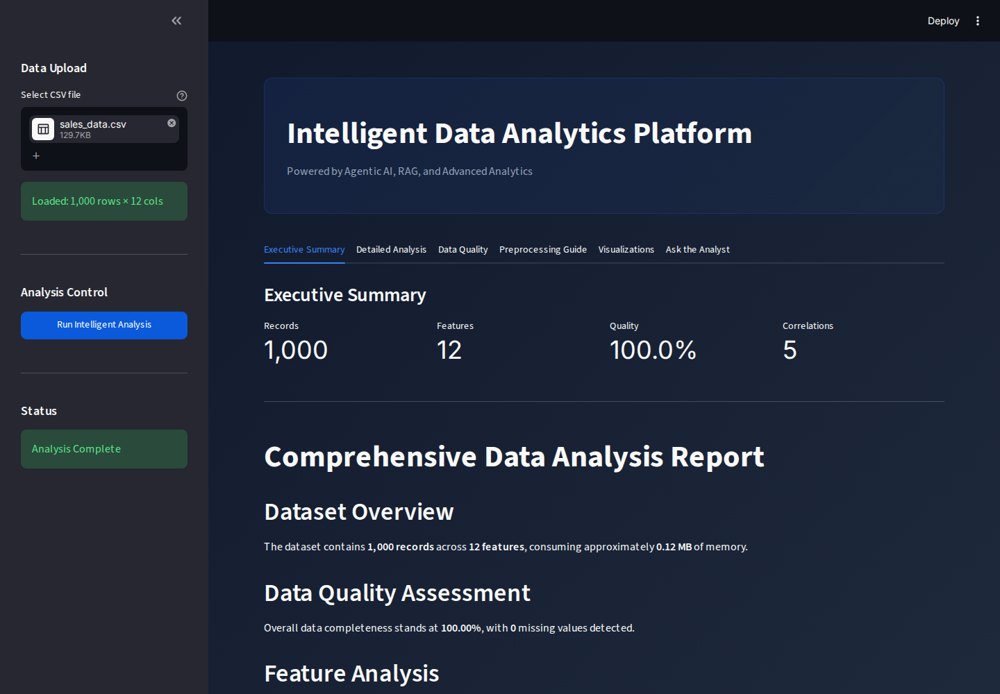
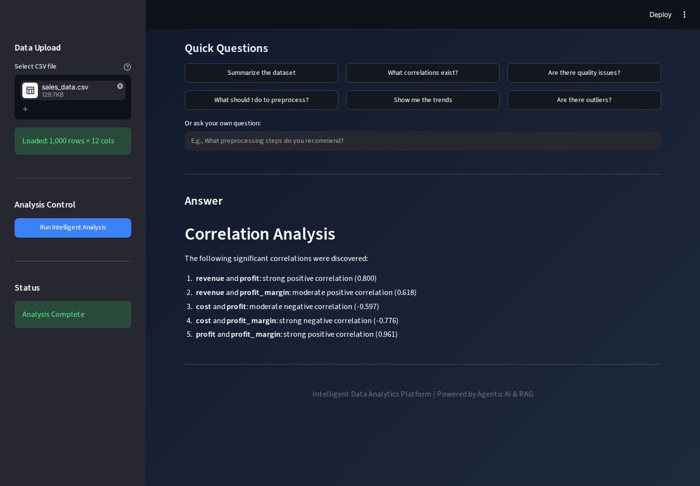
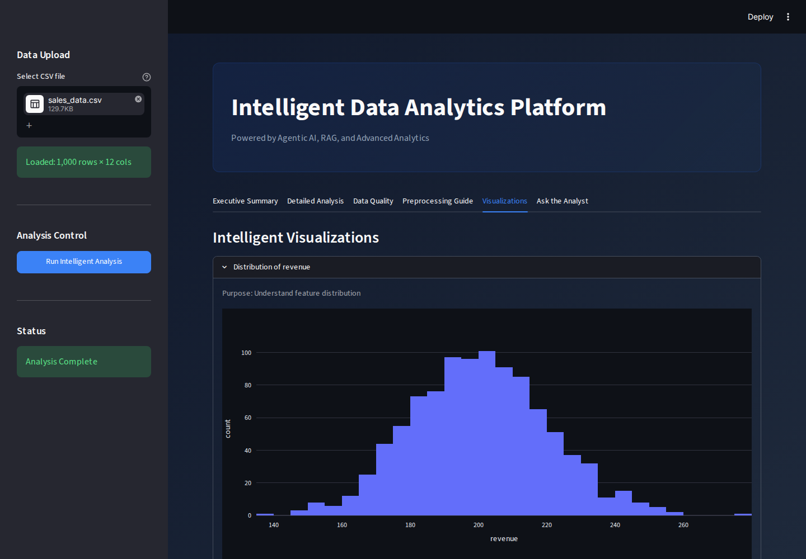
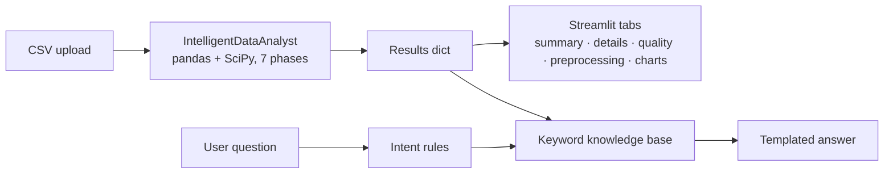

# Dashboard-demo — early AI Analytics Dashboard demo

**An early (February 2026) Streamlit demo of an automated CSV analysis app, superseded by [AI-Analytics-Dashboard](https://github.com/Akshatb848/AI-Analytics-Dashboard).**

> [!IMPORTANT]
> **This is an earlier demo, not the maintained project.** All commits here date from 1–2 February 2026 and continue the "AI Analytics Dashboard v3.0" upload. Work then continued in **[Akshatb848/AI-Analytics-Dashboard](https://github.com/Akshatb848/AI-Analytics-Dashboard)**, which has the current app (Ask Data query planner, Prophet forecasts with backtests, saved dashboards, Docker, CI). The code here is **not** a byte-for-byte copy of that repo. It is a parallel, simpler branch of the same idea, kept for history.

[](https://github.com/Akshatb848/Dashboard-demo/actions/workflows/ci.yml)
[](LICENSE)


## Glimpse

These screenshots come from running `streamlit run app_production.py` locally, uploading `sales_data.csv` produced by [`generate_test_data.py`](generate_test_data.py) (synthetic data), and capturing the result headlessly with Playwright.

| Executive summary | Ask the Analyst |
|---|---|
|  |  |



## What it does

Upload a CSV and click **Run Intelligent Analysis**. The app then runs a fixed seven-step pandas/SciPy pipeline ([`intelligent_analyst.py`](intelligent_analyst.py)):

1. Data understanding: shape, types, memory use
2. Quality assessment: completeness, missing cells, duplicates
3. Feature analysis: distributions, skew/kurtosis, correlations
4. Statistical tests: normality
5. Pattern discovery
6. Preprocessing recommendations
7. Visualisation suggestions, rendered with Plotly

The results appear in six tabs. **Ask the Analyst** answers questions with [`rag_query_engine.py`](rag_query_engine.py).

**About the "Agentic AI / RAG / LLM" labels in the UI and file names:** no language model is called anywhere in this repo. "Ask the Analyst" scores pre-written analysis snippets by keyword overlap and fills an answer template based on the detected intent. `llm_integration.py` describes itself as template-based generation. The labels are aspirational naming from the original upload.

## Architecture



## Tech stack

Python 3.11 · Streamlit · pandas · NumPy · SciPy · Plotly · pytest (Streamlit `AppTest`)

## Quick start

```bash
pip install -r requirements.txt
python generate_test_data.py          # writes synthetic CSVs to test_data/
streamlit run app_production.py       # upload test_data/sales_data.csv
```

Or with Docker: `docker build -t dashboard-demo . && docker run -p 8501:8501 dashboard-demo`.

No environment variables or API keys are needed.

## Testing

```bash
pip install pytest
pytest
```

The 13 smoke tests in [`tests/test_smoke.py`](tests/test_smoke.py) cover:
- the seven-phase pipeline on each of the five synthetic datasets
- missing-value detection on the "dirty" dataset
- an answer for each quick question
- a headless Streamlit `AppTest` run, confirming that all six tabs render after an analysis

CI runs them along with a Ruff check for syntax errors and undefined names. [`validate_system.py`](validate_system.py) is an older self-check script for `semantic_engine.py`.

## Project structure

```
app_production.py       Streamlit UI (entry point)
intelligent_analyst.py  7-phase analysis pipeline
rag_query_engine.py     keyword "knowledge base" + templated answers
semantic_engine.py      column profiling / classification (used by validate_system.py, ai_agent.py)
llm_integration.py      template-based narrative helpers (not wired into the current UI)
ai_agent.py             older Prophet/scikit-learn module (not imported by the current UI)
generate_test_data.py   synthetic datasets
tests/                  pytest smoke tests
docs/                   screenshots, original v3.0 README
```

## Limitations

- **Superseded.** Use [AI-Analytics-Dashboard](https://github.com/Akshatb848/AI-Analytics-Dashboard).
- No LLM, embeddings or retrieval model, despite the naming (see above).
- CSV only. The whole file is loaded into memory.
- `ai_agent.py`, `llm_integration.py` and `semantic_engine.py` are not used by the current UI.
- `QUICKSTART.md`, `DEPLOYMENT.md` and `apply_fix.sh` date from the original upload and may not match the current code.
- No hosted demo. Results have only been checked on the synthetic data.

## License

[MIT](LICENSE) © 2026 Akshat Banga

## Author

**Akshat Banga** — [github.com/Akshatb848](https://github.com/Akshatb848)
